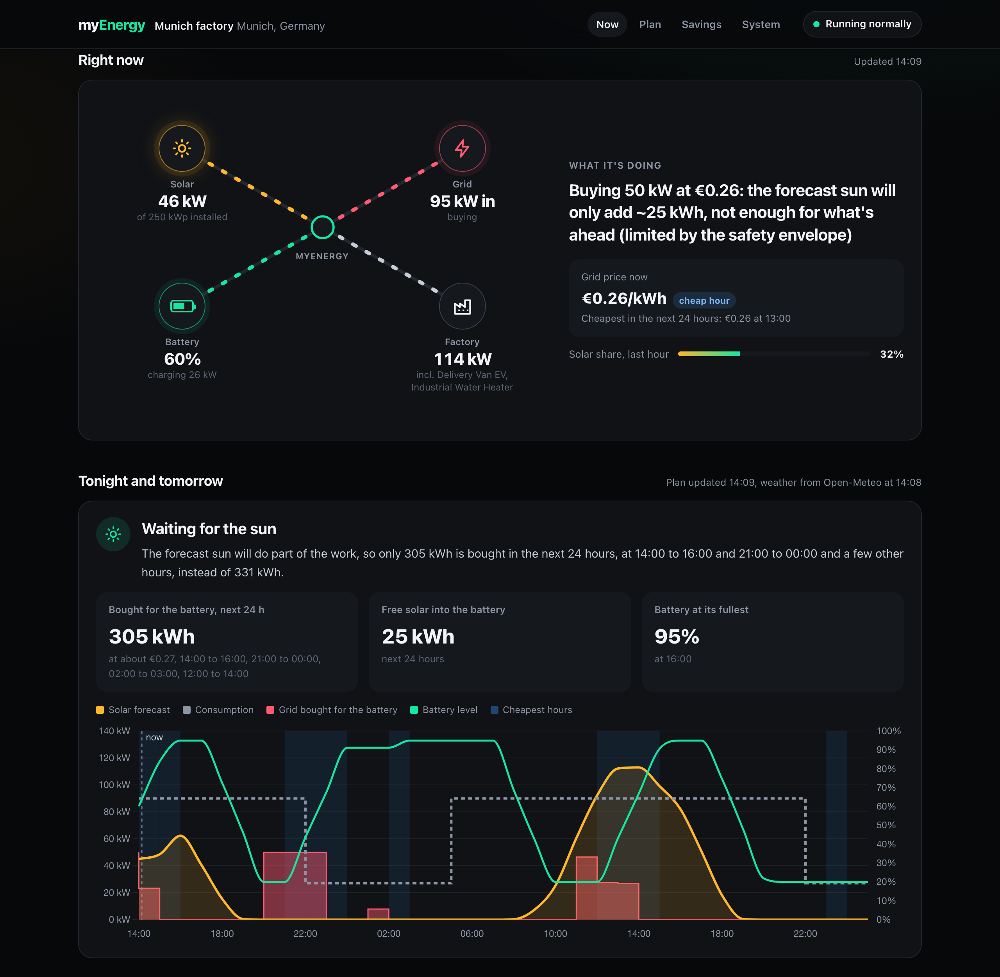

# ⚡ myEnergy

[](https://github.com/karimtataa46/myenergy/actions/workflows/tests.yml)

**Predictive energy management for factories with solar and battery storage.**



*The operator page on 18 October 2026, with the real Munich weather forecast and real German
market prices. The factory, its load and its battery are simulated.*

myEnergy controls a **simulated** factory with solar panels, a battery and a grid
connection. Every 5 seconds it decides whether the battery charges, discharges or
holds. Unlike a normal reactive controller, it is predictive: it reads a real weather
forecast and real hourly market prices, plans the next 36 hours, and stores cheap
energy before an expensive peak instead of reacting once the peak has arrived. When
the sun is due back soon, it can use the battery now and let the sun refill it,
instead of buying grid power.

**What it saves, honestly.** These numbers come from a simulation, not from a real
plant. On a simulated mid-sized factory (250 kWp solar, 200 kWh battery, day/night
tariff), one simulated month breaks down like this:

| Layer | Saves per month |
|-------|-----------------|
| Solar panels | about €7,100 |
| Battery on a simple timer (store solar, charge at the cheap night rate) | about €1,080 |
| **myEnergy's planning**, with an imperfect forecast | **about €40** (€110 with a perfect forecast) |

The panels and the night tariff save money with any controller, so only the last line
is the software's. The simulated month is summer-like (seeded weather, one cloud value
per day), so a full year would save clearly less. The "imperfect forecast" shifts each
day's cloud cover by a random amount (standard deviation 0.15).

On a fixed day/night tariff a timer already gets most of the battery's value.
Forecast-based planning matters more with hourly (dynamic) prices: in
`simulation/demo_dynamic_pricing.py` the optimiser beats a simple price-threshold rule
by about €270 a month. That demo uses simulated prices, the default 100 kWp factory,
and lets the optimiser see the real future (a perfect forecast), so it is an upper
bound, not a prediction.

An earlier version of this README claimed about €740 a month. That compared the
software with a controller that never charged at night, and let it see the real future
weather, so it credited the night tariff and a perfect forecast to the software.

> **Status:** learning prototype. The factory is a simulation, not real hardware. The
> decision engine, the optimiser and the savings maths are covered by automated tests.
> See [Known limitations](#known-limitations).

## What it does

One interface, at `/`, for the person who operates the plant. Its sections follow
the operator's questions, in order:

| Section | Answers |
|---------|---------|
| **Right now** | Is it working, and what is it doing? One sentence plus solar, consumption, battery and grid, with the current price. A status pill says if there's no forecast or the plant can't be reached. |
| **Tonight and tomorrow** | What will it do, and why? The plan's story, the grid energy bought tonight, the free solar stored, and the hour-by-hour timeline. |
| **Savings** | What is it saving, and which part is the software? The bill split into layers: solar panels, battery on a simple timer, and myEnergy's planning, for this month so far and a full month. |
| **Your system** | What is my plant? Location, solar and battery size, reserve, prices and the devices it controls. |
| **Ask your plant** | Anything else, in their own words. A corner button opens a chat with the AI assistant (below), which answers from the live data. It only appears when the assistant is running. |

All times are in the plant's local time. The simulated plant behind it is a
development tool: it lets the test suite prove the system works, and is not part
of the user's interface.

### AI agents (n8n + LLM)

On top of the API run two n8n workflows with a language model, Google Gemini (Claude
works too; details in [automation/README.md](automation/README.md)):

* **Frag deine Anlage**: a chat agent that answers the operator's questions in German or
  English by calling the myEnergy API as tools, with a system prompt that only allows
  answers grounded in the plant's real numbers.
* **Daily briefing**: every morning a short German briefing about today and tonight.
* **Evaluation**: one command asks the agent 20 questions and grades every answer against
  the API's numbers at that moment, including questions it must decline. The first real
  run graded only 7 answers (the free model quota ran out) and found two defects, now
  fixed; a full re-run is still pending.

## How it works

The project is split into a validated simulation core and a web plus control layer
built on top of it.

```
frontend/          vanilla HTML, CSS and JS (no framework)
backend/           FastAPI server
  main.py            REST API and the 5 second control loop
  energy_manager.py  the one decision entry point the loop calls
  planner.py         plans the battery over 36 hours with the LP optimiser
  brain.py           safety rules, flexible devices, and the fallback rules
  simulator.py       simulated facility hardware (solar, load, battery)
  weather.py         real forecast: Open-Meteo, then the German weather service (DWD)
  prices.py          real German day-ahead prices (Energy-Charts)
  savings.py         savings layer by layer, via the validated engine (simulated month)
  assistant.py       bridge to the AI chat agent
  database.py        SQLite history (last 24 hours)
  (estimate_service, pricing_service, facility_live, live_sim: older developer
   APIs that no page uses any more)
simulation/        the validated, tested core
  factory.py         facility model, tariffs, price series
  engine.py          energy balance physics
  optimizer.py       Model Predictive Control via linear programming (SciPy)
  controllers.py     reactive, timer and predictive controllers
  test_*.py          the test suites
automation/        AI agents on top of the API (n8n + LLM)
  workflows/         the n8n workflows, versioned as JSON
  evals/             the agent's evaluation set and runner
```

### The decision engine

The decision engine is the product; the simulation just gives it a realistic world to
act in. Strategies run on identical hardware, so the difference between them is a fair
measure of the software's value:

* **Reactive controller**: responds only to the current moment.
* **Timer** (the fair baseline): also charges the battery every night at the cheap
  rate, with no forecast.
* **Predictive optimiser** (Model Predictive Control): each step it solves a linear
  program over a rolling forecast horizon (the cheapest way to charge and discharge
  given the coming solar and prices), applies only the first action, then re solves on
  the next step with fresh data.

The software's saving is always reported as the gap between the optimiser and the timer
on the same hardware, with the optimiser steering by an imperfect forecast
(`factory.forecast_of`), never as a number the solar panels or the night tariff would
have produced anyway.

In the live system the optimiser's plan is advisory: safety rules re-check it every
tick (the battery stays between 20% and 95%, it never discharges into the grid, and
total demand stays under a 95 kW ceiling). Without a real forecast the system does not
plan at all and runs on the safe rules.

The optimiser minimises **cost**, not grid energy. Usually the two agree, but when night
power is cheap it may buy grid energy to store it for the expensive evening.

## Known limitations

* **Simulated plant.** There is no connection to real inverters, batteries or meters.
  In the live demo, the plant's solar output is taken from the same forecast the
  planner uses, so the forecast is never wrong there.
* **Two solar models disagree.** The live forecast converts sunlight at 1.0 × the
  array's rated power, while the savings simulation peaks at 0.62 ×. Real plants are
  usually around 0.75 to 0.85.
* **Solar is read one hour late.** Open-Meteo reports each hour's radiation as the mean
  of the *preceding* hour; the code treats it as the following hour.
* **The savings simulation is coarse.** One cloud value per day, a summer-like month, a
  fixed load profile with no weekends, and no demand (peak power) charge in the cost.
  "Cloudy now, sunny in two hours" never happens inside it.
* **Cost only.** No battery wear in the optimiser, no "battery full by time X" rule, and
  no option to minimise grid energy or CO₂ instead of cost.

## Run it with Docker

The whole app is containerised, so it runs the same way on any machine that has Docker
installed.

```bash
docker build -t myenergy .
docker run -p 8000:8000 myenergy
```

To run it together with n8n and the AI agents, use Docker Compose:

```bash
docker compose up -d
```


## Run it without Docker

```bash
pip install -r requirements.txt
./start.sh                               # then open http://localhost:8000
```

`start.sh` runs `uvicorn main:app --loop asyncio --http h11` from `backend/`, the same
command as the Docker image. The app calls the real Open-Meteo, DWD and Energy-Charts
APIs, so it needs internet access.

## Testing

An automated test suite runs on every push via **GitHub Actions** (the badge above is
live). It covers the full test pyramid:

| Layer | What it checks | Tools |
|-------|----------------|-------|
| **Unit** | decision rules, engine physics, pricing, models, forecast maths | pytest, fixtures, `parametrize` |
| **Integration** | services wired together, Open-Meteo HTTP calls mocked | `monkeypatch` test doubles |
| **API** | every endpoint, happy paths and error / 422 paths | FastAPI `TestClient` |
| **E2E** | the operator interface in a real headless browser | Playwright |
| **AI agents** | the n8n workflows match the API, and the eval's grader passes good answers and fails bad ones | pytest |

**276 pytest tests** (268, plus 8 browser tests), and standalone engine and optimiser
proofs, with a coverage gate enforced in CI. Every defect the suite finds is filed as an issue, fixed,
guarded by a regression test, and recorded in the [defect log](docs/BUGS.md).

Run it locally:

```bash
pip install -r requirements-dev.txt
playwright install chromium              # once, for the browser E2E tests
pytest                                   # run everything
pytest --cov=backend --cov=simulation    # with a coverage report
pytest -m "not e2e"                      # skip the slow browser tests
```

## Tech stack

Python, FastAPI, Docker and Docker Compose, SciPy (linear programming), SQLite, Open-Meteo
and DWD (weather), Energy-Charts (prices), vanilla JavaScript, Chart.js.

**AI and automation:** n8n (AI Agent, tools, memory, scheduled workflows), Google Gemini API,
prompt engineering, LLM evaluation.

**Testing and CI:** pytest, pytest-cov, FastAPI TestClient, Playwright, GitHub Actions.
