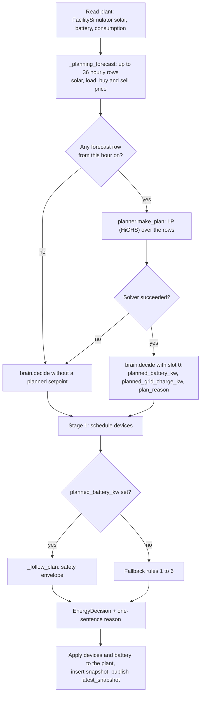

# Architecture Context

> Technical reference for the myEnergy code. Read it before you change anything.
> It describes commit `eea63ab` (committed 2026-10-08) and the working tree read on 2026-10-18
> (`README.md` modified, not committed). Facts were read from the code or measured by running it.
> On 2026-10-18: 268 non-browser tests passed (3.3 s, Python 3.9.6); the 8 browser tests were
> collected but not run. Rationale marked *(inferred)* is a reading of the code, not something the
> author wrote down. Product goals are in `project-overview.md`. Visual details are in `ui-context.md`.

## Stack

| Layer | Technology | Role |
|-------|------------|------|
| Language | Python 3.11 in Docker (`python:3.11-slim`), `runtime.txt` (`python-3.11.9`) and CI (`"3.11"`). The local `.venv` is Python 3.9.6, and the 268 non-browser tests pass on it | All backend and simulation code |
| Web framework | FastAPI 0.115.0 (pinned), Pydantic v2 (comes with FastAPI; `Field(pattern=...)` needs v2; local 2.13.4) | REST API, static page, lifespan hook |
| Server | `uvicorn[standard]` 0.30.6 (pinned). Always started with `--loop asyncio --http h11` (no uvloop, no httptools). One process, no `--workers` | Serves API and page, hosts the control loop |
| Optimiser | SciPy `linprog(method="highs")` (`scipy>=1.11,<2`, local 1.13.1), NumPy (`>=1.24,<3`, local 2.0.2) | Battery plan, one linear program per call |
| Time zones | `zoneinfo` + `tzdata>=2024.1` | Plant-local time (`Europe/Berlin`) |
| Storage | SQLite through stdlib `sqlite3`, file `data/myenergy.db` | Last 24 h of 5-second snapshots |
| Frontend | One file, `frontend/index.html` (737 lines), vanilla HTML, CSS, JS. Chart.js 4.4.0 from `https://cdn.jsdelivr.net/npm/chart.js@4.4.0/dist/chart.umd.min.js` (no integrity attribute) | Operator page |
| Weather source | Open-Meteo `api.open-meteo.com/v1/forecast`; second source: German weather service DWD (MOSMIX) through Bright Sky `api.brightsky.dev/weather`. stdlib `urllib`, 8 s timeout, no key | Hourly irradiance, cloud, temperature |
| Price source | Energy-Charts `api.energy-charts.info/price?bzn=DE-LU` (data from Bundesnetzagentur / SMARD.de, CC BY 4.0). stdlib `urllib`, 8 s timeout, no key | Day-ahead market price |
| AI assistant | n8n `docker.n8n.io/n8nio/n8n:2.41.6` (pinned), Google Gemini `models/gemini-3-flash-preview`. Claude is a documented alternative node | Read-only chat agent and daily briefing |
| Tests | pytest >=8.0 (local 8.4.2), pytest-cov >=5.0, httpx >=0.27, pytest-playwright >=0.5 (Chromium), uvicorn >=0.23 | Test pyramid (see Testing Model) |
| CI | GitHub Actions, `.github/workflows/tests.yml` | pytest with coverage gate, then two standalone proofs |
| Deployment | `Dockerfile`, `docker-compose.yml` (myEnergy + n8n), `render.yaml` (Render, Docker runtime), `Procfile`, `start.sh` | Run and host |

`requirements.txt` has five runtime dependencies: fastapi, uvicorn, scipy, numpy, tzdata. No HTTP client
library: all outgoing calls use `urllib`.

## System Boundaries

- `backend/`: the live system. FastAPI app and control loop (`main.py`), decision engine (`energy_manager.py`,
  `planner.py`, `brain.py`, `models.py`), simulated plant (`simulator.py`), data feeds (`weather.py`, `prices.py`),
  `database.py`, `savings.py`, `assistant.py`. Also four dormant developer modules (`estimate_service.py`,
  `pricing_service.py`, `facility_live.py`, `live_sim.py`, 795 lines together) and two legacy standalone runners
  (`test_energy_logic.py`, `test_livesim.py`). Must not hold battery physics or facility defaults: those live in `simulation/`.
- `simulation/`: the validated core. `factory.py` (facility facts, `FacilityConfig`, tariffs, weather and price
  generators), `engine.py` (hourly physics, `simulate`, `HORIZON_HOURS = 36`), `optimizer.py` (the LP),
  `controllers.py` (`reactive`, `timer`, `predictive`). Also standalone proofs and demos. Must not import from
  `backend/` (checked: it does not; `debug_lp.py` imports `demo_dynamic_pricing.py`, both inside `simulation/`).
- `frontend/`: `index.html` only. Served at `/` (and at `/static/index.html`). It talks only to myEnergy, never to n8n.
- `automation/`: n8n workflows as JSON (`workflows/chat-agent.json`, `workflows/daily-briefing.json`), the evaluation
  (`evals/cases.json`, `grading.py`, `run_eval.py`, standard library only), `dev/fake_anthropic.py`, `briefings/`
  (generated Markdown, git-ignored), `README.md`. The backend never imports it.
- `tests/`: the pytest suite and `conftest.py`. No `__init__.py`. Imports modules by name through `pytest.ini`.
- `docs/`: `BUGS.md` (defect log, current up to #29; no row for #39) and `DESIGN.md` (outdated: four pages, "two brains"; history only).
- `data/`: the SQLite file, created at runtime (`*.db` is git-ignored and Docker-ignored). Not copied into the image.
- `context/`: these files for AI agents. Not in git (`?? context/`). Not part of the app.

**Import rule.** Backend modules import `simulation/` modules as top-level names (`factory`, `engine`, `optimizer`,
`controllers`). `simulation/` is not a package. This works through four mechanisms:

1. `sys.path` edits in 7 modules: `weather.py`, `prices.py`, `simulator.py`, `savings.py`, `estimate_service.py`,
   `facility_live.py`, `live_sim.py`. Six guard with `if ... not in sys.path`; `savings.py` inserts without the guard.
   (`backend/test_livesim.py` also edits the path.)
2. `pytest.ini`: `pythonpath = backend simulation automation/evals`.
3. Docker: `WORKDIR /app/backend`, so `uvicorn main:app` finds the backend modules; `/app/simulation` is added by item 1.
4. `main.py` imports `weather` and `simulator` (lines 22 and 23) before `energy_manager` (29) and `from engine import` (34).

`planner.py` (imports `engine`, `optimizer`), `energy_manager.py` (imports `factory`) and `main.py` (`from engine import
HORIZON_HOURS`) do not insert the path themselves. Measured: `import planner` or `import energy_manager` alone from
`backend/` fails with `ModuleNotFoundError: No module named 'engine'`; `import main` works. `brain.py` and `models.py`
import nothing from `simulation/`. Other paths use `Path(__file__)`: `../frontend`, `../simulation`, `../data`.

## Runtime Model

One process, one worker, one plant.

**Startup (`main.lifespan`), in order:**
1. `database.init_db()`.
2. `await _refresh_forecast()`: runs `weather.fetch_real_forecast` in a thread (`asyncio.to_thread`).
3. `await asyncio.to_thread(price_book.refresh)`.
4. `asyncio.create_task(_control_loop())`.
5. `asyncio.create_task(_forecast_refresh_loop())`, then `yield`.

There is no shutdown code: the tasks are not stored or cancelled. Steps 2 and 3 block startup. Each request has an 8 s socket
timeout (per blocking operation, not a total limit), so with Open-Meteo, Bright Sky and the price API all slow, startup waits about 8 s per source or more.

**`_control_loop`**: `while True: try: <tick> except Exception as e: print(f"[control loop error] {e}")`, then
`await asyncio.sleep(TICK_INTERVAL_SECONDS)` (5). The period is 5 s plus the tick's own time. The tick runs
synchronously on the event loop. Each tick advances the plant by `dt_seconds=5`, not by measured wall time.
The tick, in order:
1. Copy `forecast_cache` under `_forecast_lock`.
2. `weather.get_current_solar(fc)`; the plant's solar is that value scaled to the array, or the clear-sky model if `None`.
3. `facility.get_battery()`, `facility.get_consumption(now)`, `upcoming` (mean forecast of the next 2 h, scaled; `0.0` without forecast).
4. `_tariff_at(now)` and `_price_limits(now)`.
5. `energy_manager.decide(BrainInput(...), _planning_forecast(fc, now), DEMO_CFG)`.
6. For each unfulfilled device: apply its command, stamp `last_change_at` on a flip, subtract `power_draw_kw * 5/3600` kWh while on.
   At `remaining_kwh_needed <= 0` the device is set to 0, switched off and stamped.
7. `facility.apply_decision(decision.battery_kw, 5)`, `facility.accumulate_stats(...)`, `facility.get_grid(decision.grid_kw)`.
8. Build `zones` (base zones plus each running device) and `devices_status`, build `snap`.
9. `database.insert_snapshot(snap)`, then replace `snap["solar_fraction"]` with `database.solar_fraction_window(60)` if it is not `None`, then `latest_snapshot = snap`.

When a tick raises: the error is printed, nothing is published, `latest_snapshot` keeps the last good dict, and state
changed earlier in the same tick (devices, battery SoC, stats) stays changed. There is no status flag and no fail-safe.
The page shows "Readings delayed" when `/api/live` `ts` is older than 60 s.

**`_forecast_refresh_loop`**: sleeps 30 min (`FORECAST_REFRESH_MINUTES`), then `await _refresh_forecast()`, then
`price_book.refresh`. It has no try/except. `_refresh_forecast` catches only `weather.ForecastUnavailable`.

**Where blocking work runs.** `/api/live`, `/api/history`, `/api/forecast`, `/api/site`, `/api/prices` run on the event
loop. `/api/plan`, `/api/savings`, `/api/assistant`, `/api/ask` and the dormant `/api/cities`, `/api/estimate`,
`/api/facility/*`, `/api/sim/*` use `asyncio.to_thread`. Only `forecast_cache` and `forecast_fetched_at` have a lock.

**Module-level state in `main.py`:**

| Name | Holds |
|------|-------|
| `facility` | `FacilitySimulator()`: battery SoC (starts at 60.0 %), stat counters |
| `latest_snapshot` | last published tick; `{}` until the first tick finishes |
| `forecast_cache` | `list[WeatherForecastHour]`, `[]` until the first successful fetch |
| `forecast_source` | label of the source that filled the cache (`""` before the first fetch) |
| `forecast_error` | text of the last failed refresh, `None` after a success |
| `forecast_fetched_at` | UTC time of the last successful fetch |
| `_forecast_lock` | `threading.Lock` for the cache and its timestamp |
| `system_devices` | two `ShiftableDevice` objects, created at import with deadlines `now + 12 h` and `now + 4 h` |
| `price_book` | `prices.PriceBook()`, no lock; `refresh` swaps `_market` by assignment |
| `ask_limiter` | `assistant.RateLimiter()` |
| `TICK_INTERVAL_SECONDS = 5`, `FORECAST_REFRESH_MINUTES = 30`, `DEMAND_TARGET_KW = 95.0`, `DEMO_CFG` | constants |

Elsewhere: `assistant._last_check`, `savings._cached` (`lru_cache(maxsize=64)`). `main.py` also does
`from live_sim import live_sim`, so a dormant `LiveSim` is built and warmed up (38 simulated hours) at import.

**Why more than one worker breaks it** (read from the code, not tested). Each worker would hold its own `facility`,
`system_devices`, caches, price book and rate limiter, and would run its own control loop. All loops would write into
the same SQLite file every 5 s. `/api/live` would return the state of whichever worker answered. A restart resets
everything in memory: SoC back to 60 %, both devices refilled (40 kWh and 10 kWh) with fresh deadlines.

## Decision Engine

### Entry point
`backend/energy_manager.py` (52 lines):
- `plan_for(battery, forecast, cfg=None) -> Optional[Plan]`: `None` if `forecast` is `None`. Otherwise
  `planner.make_plan(battery, forecast, cfg or F.DEFAULT_CONFIG, min_soc_frac=brain.BATTERY_RESERVE_SOC/100 (0.20),
  max_soc_frac=brain.BATTERY_FULL_SOC/100 (0.95))`.
- `plan_without_sun(battery, forecast, cfg=None)`: `plan_for` with `solar_kwh` replaced by zeros. The counterfactual for the story.
- `decide(inp, forecast, cfg=None) -> EnergyDecision`: `plan = plan_for(inp.battery, forecast, cfg)`. If `None`:
  `brain.decide(inp)` (rules). Else `brain.decide(replace(inp, planned_battery_kw=plan.battery_kw,
  planned_grid_charge_kw=plan.grid_charge_now_kw, plan_reason=plan.reason))`.

The loop calls `decide` once per tick (one LP solve). `main._plan_response` (behind `/api/plan`) calls `plan_for` and
`plan_without_sun` (two solves per request). A plan is never stored or cached. The page and the loop show the same plan
because they call the same functions with the same builder (`_planning_forecast`) and the same `DEMO_CFG`.
Measured on the demo plant: `plan_for` takes about 0.48 ms (36 h, fixed tariff, average of 50 calls).

### Inputs
`brain.BrainInput` fields: `solar: SolarReading`, `battery: BatteryState`, `base_load_kw`, `shiftable_devices`,
`upcoming_solar_kw`, `current_tariff_eur_kwh`, `peak_price_eur_kwh=0.0`, `offpeak_price_eur_kwh=0.0`,
`demand_target_kw=inf`, `planned_battery_kw=None`, `planned_grid_charge_kw=0.0`, `plan_reason=""`.

What `_control_loop` passes: `current_tariff_eur_kwh = _tariff_at(now)` (buy price of the current hour from `price_book`,
else `DEMO_CFG.tariff(site_hour(now))`). `peak_price_eur_kwh` and `offpeak_price_eur_kwh` come from `_price_limits(now)`:
`planner.band_limits` of the next 24 buy prices, giving `(cheap_max, dear_min)`; without prices it returns
`(DEMO_CFG.offpeak_tariff 0.12, DEMO_CFG.peak_tariff 0.28)`. The loop passes `(cheap_max, dear_min)` as
`offpeak_price_eur_kwh` and `peak_price_eur_kwh`. `demand_target_kw = 95.0`.

`models.PlanningForecast`: `hour: int` (current hour on the plant's clock), `solar_kwh: List[float]`, `load_kwh: List[float]`
(kW averages over one hour, so numerically kWh), `buy_price: Optional[List[float]]`, `sell_price: Optional[List[float]]`
(EUR/kWh). `models.BatteryState`: `soc_percent`, `power_kw`, `capacity_kwh`, `max_charge_kw`, `max_discharge_kw`;
`is_full` is `soc_percent > 95` and `is_critical` is `< 15`, both hard-coded in `models.py`.

`main._planning_forecast(fc, now)`:
1. `hour0` = `now` cut to the hour (UTC). `hours = [f for f in fc if f.timestamp >= hour0][:HORIZON_HOURS]`. Empty: return `None`.
2. `prices = price_book.next_hours(now, len(hours))`. If it returns anything, `hours = hours[:len(prices)]` (price truncation).
3. Return `PlanningForecast(hour=site_hour(now), solar_kwh=[facility.scale_to_array(f.estimated_solar_kw) ...]` (x2.5),
   `load_kwh=[facility.expected_load_kw(site_hour(f.timestamp)) ...]` (90 or 27), `buy_price=[p.buy ...]` or `None`,
   `sell_price=[p.sell ...]` or `None`).

Hour alignment: slot 0 is the forecast row stamped with the current UTC hour, and the price for the same UTC hour.
The load and the fixed tariff use the plant's local hour (`site_hour`, daylight saving included).
**Effective horizon** is `min(36, forecast rows from this hour on, price hours)`. Open-Meteo returns 48 rows starting at
00:00 UTC of the fetch day, so after 12:00 UTC fewer than 36 rows remain (25 at 23:00 UTC) until the next refresh.

### Planner
`planner.make_plan(battery, forecast, cfg, min_soc_frac, max_soc_frac) -> Optional[Plan]`:
- `dynamic = forecast.buy_price is not None`.
- `hours = min(len(solar_kwh), len(load_kwh), HORIZON_HOURS)`; if dynamic also `min(len(buy_price), len(sell_price or buy_price))`.
  `hours == 0` returns `None`.
- `plan_cfg = replace(cfg, battery_capacity_kwh/max_charge/max_discharge from the live BatteryState,
  battery_min_soc=max(cfg.battery_min_soc, min_soc_frac), battery_max_soc=min(cfg.battery_max_soc, max_soc_frac))`.
  Live result: SoC bounds 20 % to 95 % (40 to 190 kWh).
- Dynamic tariff: `price = buy_price[:hours]`; `feed_in = sell_price[:hours]` (or `cfg.feed_in_tariff`); `cheap, dear = price_bands(price)`.
  Fixed tariff: `price[k] = cfg.tariff((forecast.hour + k) % 24)` (0.28 for hours 7 to 21, else 0.12), `feed_in = 0.05`,
  `cheap = not cfg.is_peak(...)`, `dear = not cheap`.
- Calls `optimal_battery_schedule(solar, load, price, feed_in, soc_kwh, cfg=plan_cfg)`. `None` from the solver returns `None`.
- After the solve: `surplus[k] = max(solar-load, 0)`, `from_solar[k] = min(charge[k], surplus[k])`.
  `battery_kw = charge[0] - discharge[0]`. `grid_charge_now = charge[0] - from_solar[0]`.
  `solar_to_battery = sum(from_solar[:24])`. `full = soc_kwh >= plan_cfg.battery_max_soc * capacity - 1.0`.
  `reason = _explain(...)`.

**The LP** (`simulation/optimizer.py: optimal_battery_schedule`). `H = len(solar)` (at most 36), one slot per hour,
kW over a slot equals kWh. Variables `x = [charge(H) | discharge(H) | import(H) | export(H) | soc(H)]`, `N = 5H`.
- Minimise `sum_k ( price[k]*import[k] - feed_in[k]*export[k] ) - terminal_value*soc[H-1]`. `terminal_value` is `0.0`
  when `None` (all callers use 0).
- Energy balance, each k: `import[k] - export[k] + discharge[k] - charge[k] = load[k] - solar[k]`.
- Battery, each k: `soc[k] - soc[k-1] - eff_c*charge[k] + discharge[k]/eff_d = soc0` for k = 0, and `= 0` for k > 0.
  `eff_c = eff_d = 0.95` (`factory.CHARGE_EFFICIENCY`, `DISCHARGE_EFFICIENCY`).
- Bounds: `charge` in `[0, max_charge_kw]` (50); `discharge` in `[0, max_discharge_kw]` (50); `import` and `export` in
  `[0, grid_max_kw]` (250); `soc` in `[soc_min, soc_max]` (kWh).
- Solver `linprog(c, A_eq, b_eq, bounds, method="highs")`. `res.success` false returns `None`. Result keys:
  `charge, discharge, import, export, soc, cost`.
- Solar is not curtailable (the balance is an equality). No constraint forbids charging and discharging in one hour.
  `soc[0]` is bounded too, so a start SoC below `soc_min` forces charging in hour 0.
- Because a slot is one hour, the first hour's discharge is limited by the energy above the reserve. Measured: battery
  at 40 % gives -38 kW (`(80-40) kWh * 0.95`), not -50 kW.

**Price bands.** `band_limits(price)`: sort `price[:24]`, `k = max(1, len//3)`, return `(day[k-1], day[-k])` =
`(cheap_max, dear_min)`. `price_bands`: `cheap = p <= cheap_max + 1e-9`, `dear = p >= dear_min - 1e-9` for every hour
(hours beyond 24 are judged against the same limits).

**Output.** `PlanHour(offset, solar_kw, load_kw, grid_buy_kw, battery_pct, price, cheap, dear=False)`:
`grid_buy_kw = charge - from_solar`; `battery_pct = soc[k]/capacity*100` at the END of hour k.
`Plan(battery_kw, grid_charge_now_kw, solar_to_battery_kwh, reason, hours, dynamic=False)`.

**`summarize(plan, fmt_time, plan_without_sun=None) -> PlanSummary`.** Window: dynamic plans use `_next_day` (hours in
`plan.hours[:24]` with `grid_buy_kw > 0.5`); fixed plans use `_tonight` (the first run of consecutive `cheap` hours,
buying hours inside it). `buy_without_sun` uses the same window on the counterfactual plan; `sun_saves = buy_without_sun - buy`.
Without a counterfactual `sun_saves = 0`. Price: dynamic = energy-weighted mean of the buying hours; fixed = price of the first buying hour.
`fullest` = highest `battery_pct` in the first 24 hours. `cheapest` and `dearest` = min and max price in the first 24 hours.

Story tones, first match wins (`SUN_CREDIT_KWH = 5.0`):

| Condition | tone | headline |
|-----------|------|----------|
| `sun_saves > 5.0` | `sun` | Waiting for the sun |
| buying and dynamic | `buy` | Buying in the cheapest hours |
| buying (fixed tariff) | `buy` | Buying cheap power tonight |
| `solar_to_battery > 5.0` | `sun` | Running on the sun |
| otherwise | `hold` | Holding steady |

### Safety envelope: `brain._follow_plan`
Runs when `planned_battery_kw is not None`. The plan is advisory; the envelope has the last word.
Constants: `BATTERY_RESERVE_SOC = 20.0`, `BATTERY_FULL_SOC = 95.0`, `DEMAND_TARGET_KW = 95.0` (passed as `demand_target_kw`),
noise threshold 0.5 kW.

1. `planned = clamp(inp.planned_battery_kw, -max_discharge_kw, +max_charge_kw)`. `deficit = total_load - solar` (negative = surplus); `surplus = max(-deficit, 0)`.
2. `planned < 0`: if `soc_percent <= 20` then `planned = 0` (reserve). Else `planned = max(planned, -max(deficit, 0))` (never discharge into the grid).
3. `planned > 0`: if `bat.is_full` then `0`. Else `grid_allowance = planned_grid_charge_kw` if it is `> 0.5` else `0.0` (#19: below 0.5 kW the "grid part" is solver noise).
   `planned = min(planned, surplus + grid_allowance)` (#15: a too-sunny forecast must never become peak-price buying).
   Then `planned = max(0, min(planned, demand_target_kw - deficit))` (95 kW demand cap).
4. `grid_kw = deficit + planned`.
5. Action: `planned > 0.5` and `planned <= surplus + 1e-6`: `EXPORT_TO_GRID` if `grid_kw < -0.5` else `BATTERY_CHARGE_FROM_SOLAR`; `planned > 0.5` otherwise: `BATTERY_CHARGE_FROM_GRID`;
   `planned < -0.5`: `BATTERY_DISCHARGE`; else `GRID_IMPORT` if `grid_kw > 0.5`, `EXPORT_TO_GRID` if `grid_kw < -0.5`, else `SOLAR_ONLY`.
6. Reason: `inp.plan_reason` or `"Following the forecast plan"`. If `|planned - inp.planned_battery_kw| > 0.5` (the envelope changed it): charging from surplus becomes
   `"Storing N kW of free solar surplus, all that's available right now"`, anything else gets `" (limited by the safety envelope)"` appended.
7. #22 override when `|planned| <= 0.5`: if `grid_kw < -0.5` the reason becomes `"Exporting N kW of solar surplus"` (keeping the plan's text after `;` if the plan reason starts with "Exporting", else adding `", battery full"` when full).
   If `grid_kw > 0.5` and the reason contains "xporting": `"Holding the battery, the grid covers N kW"`.

### Device scheduling: `brain.decide`, stage 1
Runs in both modes, before the battery. `ShiftableDevice` fields: `id, name, power_draw_kw, is_on, must_finish_by,
remaining_kwh_needed, is_interruptible, min_on_minutes=0.0, min_off_minutes=0.0, last_change_at=None`. Methods:
`is_fulfilled` (`remaining <= 0`), `locked_on(now)` (`is_on` and minutes since last change `< min_on_minutes`), `locked_off(now)`,
`urgency(now)` (0 if fulfilled; `inf` if `power_draw_kw <= 0` (#10) or the deadline has passed; else `hours_needed / hours_left`).

Loop (unfulfilled devices, most urgent first). `solar_surplus = max(0, solar - base_load)`, `grid_used = max(0, base_load - solar)`.
- `must_run = (not interruptible and is_on) or urgency >= 1.0`; `forced = must_run or locked_on`.
- Decision order: `locked_on` -> on; `locked_off and not must_run` -> off; `must_run` -> on; `solar_surplus >= power_draw_kw` -> on;
  `is_offpeak` -> on; else off.
- If on: `from_solar = min(solar_surplus, power)`, `from_grid = power - from_solar`. If `from_grid > 0 and not forced and grid_used + from_grid > demand_target_kw`: off (deferred).
  Otherwise commit (`solar_surplus`, `grid_used`, `active_shiftable_kw` updated). A forced device may exceed the cap.
- `is_offpeak`: `current_tariff <= offpeak_price + 1e-9` if `offpeak_price_eur_kwh > 0`, else `current_tariff <= OFFPEAK_TARIFF_THRESHOLD` (0.15).
- Then `total_load = base_load + active_shiftable_kw`, `net_solar = solar - total_load`.

Devices in `main.py`: `ev_charger_1` "Delivery Van EV" (11 kW, 40 kWh, due +12 h, interruptible, min on 10 min, min off 8 min) and
`water_heater` "Industrial Water Heater" (15 kW, 10 kWh, due +4 h, not interruptible, min on 15 min, min off 10 min).
Devices are not in the LP: its load is the fixed `expected_load_kw` profile only.

### Fallback rules: `brain.decide`, stage 2
Used when `planned_battery_kw is None`, that is, no forecast rows or the solver failed. Computed before stage 1:
`arbitrage_ok = _arbitrage_worthwhile(peak, offpeak)` if both prices `> 0` else `True`. `_arbitrage_worthwhile` is
`peak * BATTERY_ROUNDTRIP_EFFICIENCY (0.88) > offpeak + BATTERY_WEAR_COST_EUR_KWH (0.04)`. It is used **only in rule 3**.
The LP uses neither number (it uses 0.95 each way and no wear cost).

| # | Condition | Result |
|---|-----------|--------|
| 1 | `soc <= 15` (`BATTERY_CRITICAL_SOC`) and `net_solar <= 0` and not off-peak | `GRID_IMPORT`, battery 0, "Battery critical (N%) ..." (else falls through, bug #12) |
| 2 | `net_solar > 0` | not full: charge `min(net_solar, max_charge)`, export the rest (`BATTERY_CHARGE_FROM_SOLAR` or `EXPORT_TO_GRID`); full: export all |
| 3 | off-peak (deficit): `charge_kw = min(max_charge, max(0, demand_target - deficit))`; `below_reserve = soc < 20` | if not full and (`arbitrage_ok` or `below_reserve`) and `charge_kw > 0.5`: `BATTERY_CHARGE_FROM_GRID`, grid = `deficit + charge_kw`; else `GRID_IMPORT` with the reason "battery full", "spread below losses+wear" or "demand cap reached" |
| 4 | peak: `solar_arriving_soon = upcoming >= 15.0` (`SOLAR_INCOMING_THRESHOLD_KW`); `reserve_soc = 20 + 10` if arriving and `soc < 45`, else 20 | sets the reserve for rule 5 |
| 5 | `soc > reserve_soc` and `deficit > 2.0` (`MIN_GRID_IMPORT_KW`) | `BATTERY_DISCHARGE`, `min(deficit, max_discharge)` |
| 6 | otherwise | `GRID_IMPORT`, "Peak but battery at reserve ..." |

Defined but not used by the live path: `brain.solar_only_mode`, `SOLAR_WAIT_HORIZON_HOURS`, `BatteryState.is_critical`,
`EnergyDecision.forecast_horizon_hours`, `database.get_recent`.

### Reason sentences: `planner._explain`
Branches, first match wins: `battery_kw > 0.5` and grid part `> 0.5` ("Buying N kW at EUR p: the forecast sun will only add ..."); `battery_kw > 0.5`
("Storing N kW of free solar surplus"); `battery_kw < -0.5`, not peak, `solar_to_battery > 5` ("Using the battery now: the forecast sun will refill it ...");
`battery_kw < -0.5` ("Discharging N kW to avoid EUR p grid power"); `surplus_now > 0.5` ("Exporting N kW of solar surplus, battery full" or "...; the battery fills from the sun later");
`full` ("Battery full, the grid covers the load at EUR p"); not peak and `solar_to_battery > 5` ("Waiting for the sun: ..."); else "Holding the battery, the grid covers the load at EUR p".
**Rule:** the sentence must never contradict the power flow. `_explain` is written for the forecast hour, and `_follow_plan` (step 6 and 7) corrects it against the live readings.

## Data Sources

### Weather (`backend/weather.py`)
- `fetch_real_forecast(lat=48.137, lon=11.575)`: tries Open-Meteo, then DWD. The first non-empty answer returns
  `(hours, source_label)`. Each failure is caught (`Exception`) and kept as `"source: ExcType: message"` cut to 200 characters. If both fail:
  `raise ForecastUnavailable("; ".join(reasons))`. Labels: `"Open-Meteo"` and `"Deutscher Wetterdienst (DWD), via Bright Sky"`.
- `fetch_open_meteo`: `hourly=shortwave_radiation,cloudcover,temperature_2m&forecast_days=2&timezone=UTC`. 48 hourly rows from 00:00 UTC of today.
  `_parse_open_meteo`: stamp -> UTC datetime; radiation, cloud (None becomes 0), temperature (None becomes 20).
- `fetch_dwd`: `date=today&last_date=today+2 days&tz=Etc/UTC`. Past hours of today are station measurements. `_parse_bright_sky`: `solar` (kWh/m2 per hour) x 1000 = W/m2;
  `cloud_cover`; `temperature` (None becomes 20.0); sorted by time; no rows raises `ValueError`.
- `irradiance_to_solar_kw(irr)` = `min(irr * 556 * 0.18 / 1000, PANEL_CAPACITY_KW)`, where `PANEL_CAPACITY_KW = factory.SOLAR_NAMEPLATE_KW = 100`. This is the **100 kWp reference array**: 1000 W/m2 gives 100 kW (raw 100.08, capped).
  `FacilitySimulator.scale_to_array` multiplies by `250/100 = 2.5`, so 1000 W/m2 gives 250 kW on the demo plant.
- `get_current_solar(forecast)`: `None` for an empty forecast. Linear interpolation by `now.minute/60` between the rows stamped `hour0` and `hour0+1`.
  Without a row for `hour0` it returns the last row at or before now (no maximum age). `get_upcoming_solar(forecast, from_now_hours)`: mean of rows with `now <= ts <= now + N h` (the loop uses 2).
- `fetch_forecast`: for the developer APIs only (`facility_live._cached_forecast`). Real forecast, else `_synthetic_forecast(lat, lon)`: 48 clear-sky rows from 00:00 UTC, cloud 15 %, 20 C,
  peak `950 * max(0.3, min(1, 1 - |lat|/120))` W/m2, solar noon `12 - lon/15` UTC, half day 6.5 h. **The live plant never calls it.**
  The `weather.py` module docstring still says it "falls back to synthetic data"; that is no longer true for the live path.
- Refresh (`main._refresh_forecast`): success replaces `forecast_cache`, sets `forecast_fetched_at`, `forecast_source`, clears `forecast_error`. `ForecastUnavailable` sets `forecast_error`
  and keeps the old cache. With no cache the plant has no forecast: rule mode, solar from the clear-sky model, `/api/plan` returns `available: false`.

### Prices (`backend/prices.py`)
- Source: Energy-Charts, bidding zone `DE-LU`, `start` and `end` as ISO dates. Prices come as 15-minute (or hourly) points in EUR/MWh.
  `hourly(unix_seconds, eur_per_mwh)`: floor each stamp to its UTC hour, divide by 1000, average per hour, skip `None`.
- `PriceBook.refresh(now=None)`: fetches plant-local (`Europe/Berlin`) days `today-1` to `today+1`. Success: `_market` replaced, `source = SOURCE_REAL`, `fetched_at = now`.
  Failure or empty answer: if real data exists, keep it (and its `source`, `fetched_at`); if there is none, or the data is already simulated, fill `_market` with `simulated_market(now, 72)` and set `source = SOURCE_SIMULATED`
  (`"simulated prices (the market prices could not be fetched)"`). `simulated_market` uses `factory.dynamic_price_series(generate_month_weather(...))` indexed from UTC midnight, so its daily shape follows UTC hours, not plant-local hours.
- `PriceBook.next_hours(now, n) -> List[HourPrice]`: for each of `n` hours from the current UTC hour: if known, use it. If not, copy the same hour from 1, 2 or 3 days earlier and set `estimated=True`.
  If none exist it returns the shorter list.
- `HourPrice(start, market, buy, sell, estimated)`. `to_hour_price`: `buy = round(market + SURCHARGE_EUR_KWH, 4)`, `sell = round(max(market - EXPORT_FEE_EUR_KWH, 0.0), 4)`.
  `SURCHARGE_EUR_KWH = 0.10` (an assumption for a mid-sized factory), `EXPORT_FEE_EUR_KWH = 0.01`. Exports never earn less than 0.
- `/api/site` always reports `tariff: "dynamic"`. The fixed tariff (0.28 for 07:00 to 21:59, 0.12 otherwise; `feed_in` 0.05) is still used by the savings model, by the fallback when `next_hours` is empty,
  by `FacilitySimulator.get_grid().tariff_eur_kwh` and by the `cost_saved_eur` counter.

## Simulated Plant
Code: `backend/simulator.py`.
- Constants: `DEMO_NAME "Munich factory"`, `DEMO_LOCATION "Munich, Germany"`, `DEMO_TIMEZONE "Europe/Berlin"`, `DEMO_SOLAR_KWP 250.0`, `BATTERY_CAPACITY_KWH 200`, `BATTERY_MAX_CHARGE_KW 50`,
  `BATTERY_MAX_DISCHARGE_KW 50`, `PEAK_TARIFF 0.28`, `OFFPEAK_TARIFF 0.12`, `ZONES` = production_line_a 35, production_line_b 28, hvac 15, lighting 8, office 4 kW (`TOTAL_BASE_CONSUMPTION_KW = 90`).
- `site_hour(dt)`: hour of day on the plant's clock (`astimezone(ZoneInfo("Europe/Berlin")).hour`). Tariffs, the work pattern and grid CO2 use it, never UTC (#18).
- `expected_load_kw(hour)`: `90 * (1.0 if 6 <= hour <= 22 else 0.3)`, so 90 kW or 27 kW.
- **`DEMO_CFG`** = `replace(F.DEFAULT_CONFIG, solar_nameplate_kw=250, solar_peak_kw=62*2.5=155, load_profile_kw=[expected_load_kw(h)], battery 200/50/50, peak_tariff=0.28, offpeak_tariff=0.12)`.
  Unchanged defaults: `battery_min_soc 0.10`, `battery_max_soc 1.00`, efficiencies 0.95, `grid_max_kw 250`, `feed_in_tariff 0.05`, peak hours `[7, 22)`, CO2 0.21 / 0.12 kg/kWh.
  It is the single config read by the loop, the planner (through `main`), `/api/site`, `savings.py` and the simulator's own methods.
- `FacilitySimulator`:
  - `__init__`: `battery_soc = 60.0`; counters for CO2, cost, grid kWh, solar kWh.
  - `scale_to_array(reference_kw)`: `x 2.5`.
  - `get_solar(override_kw=None)`: with an override, that value. Without: `_simulate_solar` = for local hour 6 to 20, `(155 + uniform(-5, 5)) * sin(pi*(hour-6)/14)`, else 0 (unseeded `random`).
    The loop passes the forecast value, so the snapshot says `solar_source: "forecast"`; with none, `"clear-sky model"`.
  - `get_battery()`: `BatteryState(soc_percent=round(soc, 1), capacity 200, 50, 50)`.
  - `get_consumption(now)`: zones x `expected_load/90` x one `uniform(0.95, 1.05)` noise factor per call.
  - `get_grid(net_import_kw)`: import / export split, rounded to 2 decimals, `+ 0.0` removes `-0.0`.
  - `apply_decision(battery_kw, dt_seconds)`: `soc += battery_kw * dt/3600 / 200 * 100`, then clamp to **5 to 100 %**. No efficiency loss, no power limit.
  - `accumulate_stats(solar_kw, grid_kw, dt)`: `self_used_solar = max(solar - export, 0) * dt/3600`; `co2_saved += self_used * F.grid_co2(local hour)`; `cost_saved += self_used * DEMO_CFG.tariff(local hour)`; plus solar and grid kWh totals.
  - `solar_fraction` = solar kWh / (solar kWh + grid import kWh) since start. `main` replaces it with the 60-minute window from SQLite when available.
- The plant is driven directly by the loop (no interface class). The module docstring says that in production a gateway replaces it.

## Savings Model
Code: `backend/savings.py`. All figures are **simulated, not measured**. `layers(days, forecast_error=0.15)`:
- `weather = F.generate_month_weather(days, seed=42)`: per day one random roll: `< 0.40` cloud `uniform(0, 0.25)`; `< 0.75` cloud `uniform(0.25, 0.60)`; else `uniform(0.60, 0.95)`. One `cloud_factor` per day.
  Hourly solar = `clear_sky_kw(hour) * (1 - 0.85 * cloud_factor)`, sine from 06:00 to 20:00, peak 155 kW.
- Four runs through `engine.simulate(weather, controller, cfg=...)`:
  1. `grid_only`: `_idle` controller, `replace(DEMO_CFG, solar_peak_kw=0.0)`.
  2. `solar`: `_idle`, `DEMO_CFG`.
  3. `with_timer`: `controllers.timer` (store surplus; charge at the cheap hours at full rate up to `battery_max_soc`; cover the deficit in peak hours).
  4. `myenergy`: `optimizer.optimal` with `forecast=F.forecast_of(weather, error=0.15)` (each day's cloud factor plus `gauss(0, 0.15)`, clipped to 0..1, seed 1).
- `engine.simulate` steps hour by hour. The controller sees the real solar for the current hour and forecast solar for the rest of a 36-hour window; load is exact. `_apply_battery` enforces rate limits, SoC bounds (`cfg.battery_min_soc` /
  `battery_max_soc`, here 10 % to 100 %), and efficiency 0.95 each way. Grid net = `load - solar + battery_ac`; cost = `import * cfg.tariff(hour) - export * cfg.feed_in_tariff` (fixed day/night tariff). Start SoC = 10 % (20 kWh).
- Result keys: `bill_without_anything_eur`, `bill_eur`, `saved_by_solar_eur`, `saved_by_battery_timer_eur`, `saved_by_myenergy_eur` (= timer cost minus myenergy cost), `myenergy_pct_of_bill`, `co2_avoided_kg`.
- Measured 2026-10-18 for 30 days: bill without anything 12,668.40; bill 4,433.83; solar 7,113.12; timer 1,080.50; myEnergy 40.95 (`myenergy_pct_of_bill` 0.9, which is the saving divided by the timer's cost, not by the final bill); with a perfect forecast (`forecast_error=0.0`) 111.13. `layers(30)` takes about 0.4 s.
- `_cached(days)` is `lru_cache(maxsize=64)`. `month_to_date()` uses the UTC date: `so_far = layers(now.day)`, `full_month = layers(30)`, `days_in_month` from `calendar.monthrange`.
  Response: `month` ("October 2026"), `days_elapsed`, `days_in_month`, `so_far{...}`, `full_month{...}`, `forecast_error_pct` (15), `weather: "simulated"`.
- The `optimal` controller is the same LP function as the live planner, but with a fixed tariff, SoC bounds 10 % to 100 %, no safety envelope and no devices.

## API
Sixteen routes in `main.py`, plus FastAPI's `/docs`, `/redoc`, `/openapi.json` and the `/static` mount (the `frontend/` folder). No authentication. CORS: `allow_origins=["*"]`, all methods, all headers.
The old pages `/estimate`, `/facility`, `/sim`, `/plan` return 404 (`tests/test_api.py::TestPages`).

| Method | Path | Purpose | Caller | Main response fields |
|--------|------|---------|--------|----------------------|
| GET | `/` | The page, with `Cache-Control: no-cache, no-store, must-revalidate` | browser | `index.html` |
| GET | `/api/live` | `latest_snapshot` | UI every 5 s; n8n `get_live`; briefing | `{}` before the first tick. Else `ts, solar_kw, solar_source, battery_soc, battery_kw, grid_import_kw, grid_export_kw, consumption_kw, zones{}, devices[{name,on,remaining_kwh,urgency}], action, reason, co2_saved_kg, cost_saved_eur, solar_fraction, upcoming_solar_kw, solar_peak_kw, tariff` |
| GET | `/api/plan` | Plan, summary, story, timeline | UI every 60 s (30 s if unavailable, 10 s retry on error); n8n `get_plan`; briefing | Available: `available, generated_at, forecast_fetched_at, forecast_source, forecast_error, site{}, story{tone,headline,detail}, summary{buy_tonight_kwh, buy_without_sun_kwh, buy_from, buy_until, buy_price, solar_to_battery_kwh, fullest_battery_pct, fullest_at, buy_windows, cheapest_at, cheapest_price, dearest_at, dearest_price}, hours[{time,label,solar_kw,load_kw,grid_buy_kw,battery_pct,price,cheap,dear}]`. Not available: `{available:false, message, forecast_error}` (HTTP 200). `hours[k].battery_pct` is the level at the START of hour k (hour 0 = live SoC), `label` is plant-local `HH:MM` |
| GET | `/api/savings` | `savings.month_to_date()` (in a thread) | UI at load and every 5 min; n8n `get_savings`; briefing | see Savings Model |
| GET | `/api/site` | `_site_info()` | UI once at load (retries every 10 s until it works); n8n `get_site`; Docker healthcheck | `name, location, timezone, solar_kwp, battery_kwh, battery_power_kw, reserve_pct, tariff, price_source, surcharge_eur_kwh, export_fee_eur_kwh, devices[{name,power_kw}]` |
| GET | `/api/assistant` | Is the agent reachable | UI every 60 s | `{available: bool}` |
| POST | `/api/ask` | One question to the agent | UI | `{answer}` or `{error}` |
| GET | `/api/history?minutes=60` | Snapshot rows from SQLite, oldest first | developer (not UI, not n8n) | snapshot columns; `zones` as an object |
| GET | `/api/forecast` | Next 24 forecast rows from the current hour | developer | `[{ts, solar_kw (scaled to 250 kWp), irradiance, clouds}]` |
| GET | `/api/prices` | Next 36 hourly prices | developer | `source, fetched_at, surcharge_eur_kwh, hours[{time,label,market,buy,sell,estimated}]` |
| GET | `/api/cities?q=` | City autocomplete (Open-Meteo geocoding) | dormant | `[]` for fewer than 2 characters |
| POST | `/api/estimate` | Savings estimate for a prospect (`EstimateIn`) | dormant | `estimate_service.estimate_savings` dict |
| POST | `/api/facility/start` | Start a per-facility live session | dormant | `{session}` or `{error}` |
| GET | `/api/facility/live?session=` | State of that session | dormant | state dict or `{error:"session expired"}` |
| GET | `/api/sim/live?session=&speed=` | Advance an accelerated simulation | dormant | `live_sim` state |
| POST | `/api/sim/reset?session=` | Reset it | dormant | `{ok:true}` |

**Validation.** `EstimateIn`: `city: str` (required), `solar_kwp=100.0`, `battery_kwh=200.0`, `monthly_kwh=46920.0`, optional `lat, lon, country, country_code`; no range limits.
`AskIn`: `question` 1 to 500 characters, `session_id` 8 to 64 characters matching `^[A-Za-z0-9-]+$`.

**Error shapes.**
- `/api/ask` checks in this order: Pydantic validation -> 422 with FastAPI's default `{"detail": [...]}` (not `error`); blank after `strip()` -> 422 `{"error": "Please type a question."}`; no `AGENT_URL` -> 503
  `{"error": "The assistant isn't set up on this server."}`; rate limit -> 429 `{"error": "That's a lot of questions at once. Please wait a minute."}`; `AgentTimeout` -> 504; `AgentError` -> 503 (both `{"error": message}`).
- Other failures return HTTP 200: `/api/estimate` and `/api/facility/start` with an unknown city `{"error": ...}`; `/api/facility/live` with an unknown session `{"error": "session expired"}`; `/api/plan` without forecast `available: false`.
- Invalid types on `/api/estimate` give the default 422.

## Storage Model
- **SQLite** `data/myenergy.db` (`database.DB_PATH` = `backend/../data/myenergy.db`). `init_db()` creates the folder and, if missing, table `snapshots` and index `idx_ts ON snapshots(ts)`.
  Columns: `id INTEGER PRIMARY KEY AUTOINCREMENT, ts TEXT NOT NULL, solar_kw, battery_soc, battery_kw, grid_import_kw, grid_export_kw, consumption_kw, zones TEXT (JSON), action, reason, co2_saved_kg, cost_saved_eur, solar_fraction, upcoming_solar_kw` (REAL unless noted).
  `ts` is an ISO-8601 UTC string, compared as text. A new connection is opened per call; no WAL.
- **Retention:** `RETENTION_HOURS = 24`. Every `insert_snapshot` also runs `DELETE FROM snapshots WHERE ts < now - 24 h`. At one row per 5 s that is at most about 17,280 rows.
- **Reads:** `get_history_minutes(minutes)` (behind `/api/history`), `solar_fraction_window(minutes=60)`: `SUM(solar_kw) / (SUM(solar_kw) + SUM(grid_import_kw))` over the window, rounded to 3 decimals, `None` if the total is 0.
  The stored `solar_fraction` column holds the since-restart counter, because the window value is set after the insert. `get_recent(limit=720)` exists; no route uses it.
- **Not stored in SQLite:** `devices`, `solar_source`, `solar_peak_kw`, `tariff` (they exist only in `/api/live`).
- **In memory (lost on restart):** `latest_snapshot`, forecast cache and its metadata, `PriceBook`, device state, `FacilitySimulator` state, rate limiter, `assistant._last_check`, savings cache.
- **Not stored anywhere:** plans, forecast history, price history, decisions older than 24 h, forecast-versus-actual solar, measured savings.
- **Docker:** the image does not contain `data/`. The folder is created inside the container (`/app/data`). `docker-compose.yml` has no volume for it (only `n8n_data` and two bind mounts for n8n), so removing the container removes the database.

## AI Assistant Boundary
- **`backend/assistant.py`:** `AGENT_URL = os.environ.get("AGENT_URL", "")` read at import. `TIMEOUT_S = 90`, `MAX_PER_MINUTE = 5`, `CHECK_EVERY_S = 30`.
  `configured()` = `bool(AGENT_URL)`. `available()`: false if not configured; else `urlopen(AGENT_URL, timeout=3)` (a GET of the chat page, no model call), result cached 30 s in `_last_check`; `URLError` / `OSError` mean false.
  `ask(question, session_id)`: POST `{"action": "sendMessage", "sessionId": "web-<session_id>", "chatInput": question}`; answer = `reply["output"]` stripped.
  Timeouts (`TimeoutError`, `socket.timeout`, or a `URLError` whose reason is one) raise `AgentTimeout`; other `URLError` / `ValueError` / `OSError` raise `AgentError("The assistant can't answer right now. Please try again later.")`; an empty answer raises `AgentError("The assistant had no answer. Try asking in a different way.")`.
  `RateLimiter(limit=5, window=60.0, clock=time.monotonic)`: a deque of times per visitor; the key is `request.client.host` (`"unknown"` if missing). The app reads no `X-Forwarded-For`. Refused calls are not counted; calls that later fail are.
- **Path:** browser -> `POST /api/ask` -> `assistant.ask` -> `AGENT_URL` (in Compose `http://n8n:5678/webhook/f3a1c2d4-5e6f-4a7b-8c9d-0e1f2a3b4c5d/chat`) -> n8n AI Agent (Gemini, window memory of the last 5 exchanges)
  -> four HTTP tool nodes (GET only, `$env.MYENERGY_URL` = `http://myenergy:8000`): `get_live` -> `/api/live`, `get_plan` -> `/api/plan`, `get_savings` -> `/api/savings`, `get_site` -> `/api/site`.
- **n8n is private:** published as `127.0.0.1:5678:5678`; the browser never talks to it. Without `AGENT_URL` (the Render demo) the page hides the button.
- **Daily briefing** (`daily-briefing.json`): schedule 06:30 (`TZ=Europe/Berlin`) and `GET /webhook/briefing`. It fetches `/api/plan`, `/api/live`, `/api/savings`; a Code node computes the facts; Gemini writes German text;
  the file goes to `automation/briefings/YYYY-MM-DD.md` (mounted at `/home/node/.n8n-files/briefings`).
- **Evaluation** (`automation/evals/`): 20 cases (tags: plan 5, live 4, scope 4, savings 3, site 2, multi 2, memory 1). `run_eval.py --api-url http://localhost:8000` asks the agent, reads the API at the same moment, and grades each answer
  (`tools, number, grounded, language, must_match / must_not_match, length, plain_text`). Results go to `automation/evals/results/` (git-ignored). Last recorded run (`automation/README.md`, 2026-10-04): 4 of 7 graded, 12 unanswered (free-tier quota); a clean re-run is pending.
- **Control path independence:** `_control_loop` does not import or call `assistant`. Only the routes `/api/assistant` and `/api/ask` use it. If n8n is down, nothing else changes.

## Testing Model
pytest collects **276 tests** (`pytest --collect-only`): 268 plus 8 browser tests marked `e2e`. Layout: `pytest.ini` has `testpaths = tests`, `python_files = test_*.py`, marker `e2e`, `addopts = -q`.

| File | Tests | Checks |
|------|------:|--------|
| `test_brain.py` | 36 | fallback rules, device scheduling, `_follow_plan`, min-runtime locks |
| `test_planner.py` | 17 | plan decisions, `energy_manager`, live forecast builder, timeline and story |
| `test_dynamic_prices.py` | 10 | buying in cheap hours, waiting for the sun with prices, price bands, live system uses prices |
| `test_acceptance.py` | 9 | "wait for the sun" end to end through `energy_manager.decide` |
| `test_engine.py` | 16 | `_apply_battery`, energy balance, solar fraction, `simulate` |
| `test_models.py` | 10 | device fulfilment, urgency, locks |
| `test_weather.py` | 14 | parsers, DWD fallback, no invented weather, kept forecast, plan names its source |
| `test_prices.py` | 12 | hourly averaging, surcharge, `PriceBook`, `/api/prices` |
| `test_site_time.py` | 7 | plant-local clock (#18) |
| `test_savings.py` | 10 | layers add up, timer baseline, forecast error |
| `test_api.py` | 23 | every route, error and 422 paths, old pages 404 |
| `test_assistant.py` | 22 | `/api/assistant`, `/api/ask`, limits, availability cache |
| `test_workflows.py` | 17 | n8n JSON: tool URLs exist, wiring, model settings, no secrets |
| `test_eval_grading.py` | 38 | the evaluation grader passes good answers and fails bad ones |
| `test_integration.py`, `test_pricing.py`, `test_pure_functions.py` | 7, 10, 10 | dormant estimate and facility services, tariff table, pure helpers |
| `test_e2e.py` | 8 | Playwright, real headless Chromium against a real server |

**Fixtures (`tests/conftest.py`).** `make_solar`, `make_battery(soc=60.0, capacity=200.0, max_charge=50.0, max_discharge=50.0)`, `make_device`, `make_input(base=90.0, tariff=0.28, peak=0.28, offpeak=0.12, demand=inf, ...)`:
factories that build the model objects. `fake_place`, `fake_market(first, last)`: a daily price shape. `mock_network` patches `prices.fetch_market`, `weather.fetch_forecast` (synthetic), `weather.fetch_real_forecast` (synthetic, labelled `"test forecast"`),
`pricing_service.resolve_city` and `search_cities`. `client`: `mock_network` + `database.insert_snapshot` suppressed + `with TestClient(main.app)`, which runs the lifespan (both background tasks start; `init_db` still runs).
`live_server`: `uvicorn.Server` in a daemon thread on a free `127.0.0.1` port (`loop="asyncio", http="h11"`). **`no_internet` (autouse)** patches `socket.create_connection` and raises `OSError("tests must not reach the internet (tried <host>)")` for any host other than
`localhost`, `127.0.0.1`, `::1`. The browser in the E2E tests is a separate process and may load Chart.js from the CDN. `main` holds global state, so it persists between tests in one process (tests patch `main.forecast_cache`).

**Acceptance tests ("wait for the sun")**, `tests/test_acceptance.py`: `run_two_days(tomorrow_cloud)` steps `energy_manager.decide` hour by hour through two days that differ only in tomorrow's cloud factor (0.0 or 0.95), with real physics (`_apply_battery`).
Tests: sunny overnight grid charging is more than 30 kWh below cloudy; cheaper than the forecast-blind engine (by more than EUR 1); no grid charging in peak hours; never below the 20 % reserve (within 0.5 %);
the demo plant has a midday surplus above 20 kW; the demo plant waits for the sun (same 30 kWh margin).

**Standalone proofs run in CI** (`cd simulation`): `verify_simulation.py` (input checks, hand-computed known answers, physics laws, output sanity) and `test_decisions.py` (brute-force oracle against the LP, decision laws, `optimal <= rules <= reactive`).
Both print PASS / FAIL lines and have no `sys.exit`, `raise` or `assert` for a failed check, so the step exits 0 unless Python itself raises. Run on 2026-10-18: 12 passed, 0 failed (`test_decisions.py`).
**Coverage gate in CI:** `pytest --cov=backend --cov=simulation --cov-report=term-missing --cov-fail-under=40`. CI steps: checkout, Python 3.11 with pip cache, `pip install -r requirements.txt -r requirements-dev.txt`,
`python -m playwright install --with-deps chromium`, the pytest step, the proofs. Triggers: push and pull request on `main`.
**Legacy runners pytest does not collect** (they are outside `tests/`): `backend/test_energy_logic.py`, `backend/test_livesim.py`, `simulation/test1_profile.py` to `test5_optimal.py`, `stress_test.py`, `debug_lp.py`, `demo_dynamic_pricing.py`.
Six run their checks on import (no `__main__` guard): both `backend/test_*.py`, `simulation/verify_simulation.py`, `test_decisions.py`, `stress_test.py`, `debug_lp.py`.

Run locally: `pip install -r requirements-dev.txt`, `playwright install chromium`, then `pytest`, `pytest -m "not e2e"`, or `pytest --cov=backend --cov=simulation`.

## Deployment
- **`Dockerfile`:** `FROM python:3.11-slim`; `WORKDIR /app`; copy `requirements.txt` and `pip install --no-cache-dir` (prebuilt wheels, no compilers); copy `backend/`, `frontend/`, `simulation/` (not `data/`, `automation/`, `docs/`, `tests/`);
  `WORKDIR /app/backend` (because `main.py` imports its sibling modules as top-level names, and the `../frontend`, `../simulation`, `../data` paths resolve to `/app/...`); `ENV PORT=8000`; `EXPOSE 8000`;
  `CMD uvicorn main:app --host 0.0.0.0 --port ${PORT:-8000} --loop asyncio --http h11` (shell form so `${PORT}` expands). No `USER` (runs as root), no `HEALTHCHECK` in the image.
- **`Procfile`:** `web: cd backend && uvicorn main:app --host 0.0.0.0 --port $PORT --loop asyncio --http h11`.
- **`start.sh`:** `set -e`, `cd` to `backend/`, `exec python3 -m uvicorn main:app --host 0.0.0.0 --port "${PORT:-8000}" --loop asyncio --http h11`. The README's "without Docker" command is `cd backend && uvicorn main:app --port 8000` (no loop flags).
- **`render.yaml`:** one web service `myenergy`, `runtime: docker`, `dockerfilePath: ./Dockerfile`, `plan: free`, `autoDeploy: true`. No environment variables, so `AGENT_URL` is unset and the assistant is hidden.
- **`docker-compose.yml`:**
  - `myenergy`: `build: .`, port `8000:8000`, `AGENT_URL=http://n8n:5678/webhook/f3a1c2d4-5e6f-4a7b-8c9d-0e1f2a3b4c5d/chat`, healthcheck `python -c "import urllib.request; urllib.request.urlopen('http://localhost:8000/api/site')"`
    (interval 10 s, timeout 5 s, retries 6), `restart: unless-stopped`.
  - `n8n`: image `docker.n8n.io/n8nio/n8n:2.41.6`, port `127.0.0.1:5678:5678`, `GENERIC_TIMEZONE` and `TZ` `Europe/Berlin`, `N8N_DIAGNOSTICS_ENABLED=false`, `N8N_PERSONALIZATION_ENABLED=false`, `N8N_SECURE_COOKIE=false`,
    `MYENERGY_URL=http://myenergy:8000`, `N8N_BLOCK_ENV_ACCESS_IN_NODE=false`; volumes `n8n_data:/home/node/.n8n`, `./automation/workflows:/workflows`, `./automation/briefings:/home/node/.n8n-files/briefings`;
    `depends_on: myenergy: condition: service_healthy`; `restart: unless-stopped`.
  - Volumes: `n8n_data`. Workflows are imported by hand (`n8n import:workflow`) and the Gemini credential is set in the n8n editor.
- **`.dockerignore`:** `.git/`, `__pycache__/`, `*.pyc`, `*.pyo`, `.venv/`, `venv/`, `env/`, `data/*.db`, `data/*.sqlite*`, `*.log`, `.DS_Store`, `.idea/`, `.vscode/`.

## Key Decisions

| # | Decision | Why | Source |
|---|----------|-----|--------|
| D-1 | **MPC with a linear program** for the battery | It is how grid-scale batteries are dispatched; it finds schedules no rule-writer would; fast and deterministic. Rules came first as a baseline (`brain.py` header: "the RIGHT approach before adding ML"); ML is not used | documented (`optimizer.py`, `brain.py` headers) |
| D-2 | **Hourly slots, 36-hour horizon**, terminal value 0 | With a 36 h rolling horizon end effects are negligible and 0 matches the global optimum (`optimizer.py` comment, `debug_lp.py`). Prices and forecasts arrive hourly *(inferred)*. The real horizon can be shorter (see Inputs) | documented (`optimizer.py`) / inferred |
| D-3 | **Receding horizon**: apply the first hour, plan again next tick | A wrong forecast corrects itself | documented (`planner.py`, `optimizer.py`) |
| D-4 | **Safety rules outrank the plan** | A forecast can be wrong; a drained battery or an export from the battery cannot be undone | documented (`_follow_plan`; bugs #12, #15, #19) |
| D-5 | **Rule engine kept as fallback** | The plant always has an answer without weather or solver | documented (`energy_manager.py`) |
| D-6 | **Real weather only** (Open-Meteo, then DWD, never a made-up forecast) | A fake sunny day makes the plant wait for sun that never comes (#39). No real forecast means rules | documented (`weather.py: fetch_real_forecast`, `main._refresh_forecast`) |
| D-7 | **Real day-ahead prices** plus a flat 0.10 EUR/kWh surcharge | Planning beats a timer on dynamic tariffs (README). The surcharge is an assumption for a mid-sized factory | documented (`prices.py`, README) |
| D-8 | **Honest savings**: only the gap to a battery on a timer, with 15 % forecast error | An earlier README claim (EUR 740/month) credited the software with what panels and the night tariff do anyway | documented (README, `savings.py`) |
| D-9 | **The LLM is outside the control path**, read-only, behind the API | Control stays deterministic and testable; answers are graded against the API's numbers | documented (`assistant.py`, `automation/README.md`) |
| D-10 | **n8n is private**; the browser only talks to myEnergy | Keeps model quota and the agent off the internet; one place to rate-limit | documented (`assistant.py` header, `docker-compose.yml`) |
| D-11 | **One FastAPI process, vanilla JS page, SQLite** | Smallest thing that runs the loop and serves the page; no build step | inferred |
| D-12 | **Simulation core as a separate validated folder** (`simulation/`) | One physics, proven by standalone checks, shared by the live system and the savings maths. (Several modules call it the "single source of truth" for facts.) | inferred (package split) / documented (comments) |
| D-13 | **Every decision carries a plain-language reason** that must match the power flow | Operators trust what they can read (#22) | documented (`_follow_plan`, README) |
| D-14 | **Plant-local time** for tariffs, work pattern and CO2 | UTC hours made cheap power "run until 09:00" in Munich (#18) | documented (`simulator.site_hour`, `docs/BUGS.md`) |
| D-15 | **Test pyramid, no internet in tests, CI on every push** | Defects were found late; each fix gets a regression test | documented (`docs/BUGS.md`, `conftest.py`, README) |

## Known Limitations
Facts about the current architecture. They agree with README's "Known limitations".

1. **Two solar scales.** `weather.irradiance_to_solar_kw` gives 1.0 x nameplate at 1000 W/m2 (100 kW for the 100 kWp reference, 250 kW on the demo plant after x2.5).
   `factory.SOLAR_PEAK_KW = 62` (0.62 x) feeds the clear-sky model: `DEMO_CFG.solar_peak_kw = 155`, used by `savings.py` and by `FacilitySimulator._simulate_solar`. README: real plants are usually 0.75 to 0.85.
2. **Forecast hour shift.** Open-Meteo documents `shortwave_radiation` as "average of the preceding hour" (checked on open-meteo.com/en/docs, 2026-10-18).
   `weather._parse_open_meteo` keeps the stamp, and `main._planning_forecast`, `get_current_solar` and the plan treat the value stamped 12:00 as production for 12:00 to 13:00. Bright Sky's `solar` stamp meaning was not verified.
3. **The live plant's solar comes from the forecast it plans with.** `_control_loop` passes `scale_to_array(get_current_solar(fc))` to `facility.get_solar`. Forecast error only appears in the savings month (15 %).
4. **No plant interface.** `_control_loop` calls `FacilitySimulator` methods directly (`get_solar`, `get_battery`, `get_consumption`, `apply_decision`, `accumulate_stats`, `get_grid`). Setpoints are not read back. A tick error is printed and the last snapshot stays published.
5. **Battery wear is not in the LP.** `brain._arbitrage_worthwhile` (0.88 round trip, 0.04 EUR/kWh wear) is used only by fallback rule 3. The LP uses 0.95 each way and no wear. The live simulator applies no losses at all.
6. **Objective is cost only.** `optimizer.optimal_battery_schedule` has no grid-kWh or CO2 term. There is no "ready by time T" constraint: SoC bounds are the same in every hour.
7. **The first plan hour limits power by energy.** A one-hour slot caps hour-0 discharge at the energy above the reserve (-38 kW at 40 % SoC), so the setpoint falls as the battery nears 20 %.
8. **Savings and live plan use different tariffs and limits.** `savings.py` uses the fixed 0.28 / 0.12 tariff and SoC 10 % to 100 %, no demand charge, no weekends, one cloud factor per day, a summer-like seeded month. The live plan uses hourly prices and SoC 20 % to 95 %.
9. **Site facts and battery limits are spread over modules.**
   - Battery: `factory.py` (200 kWh, 50 / 50 kW, SoC 0.10 / 1.00, efficiency 0.95), `simulator.py` (same capacity and power again, SoC clamp 5 to 100), `brain.py` (15 / 20 / 95, round trip 0.88, wear 0.04), `models.py` (`is_critical < 15`, `is_full > 95`), `main.py` (`DEMAND_TARGET_KW = 95`).
   - Location and time: `weather.py` (`DEFAULT_LAT`, `DEFAULT_LON`), `factory.FacilityConfig` (latitude, longitude), `simulator.py` (`DEMO_LOCATION`, `DEMO_TIMEZONE`), `prices.py` (`SITE_TZ` and the `DE-LU` zone, separate from `DEMO_TIMEZONE`).
   - Array: `simulator.DEMO_SOLAR_KWP`, `weather.PANEL_*`, `factory.SOLAR_*`. Tariff: `factory.py` and `simulator.py` both define 0.28 / 0.12. Load: `simulator.ZONES` / `expected_load_kw` and `factory.LOAD_PROFILE_KW` (a different profile).
10. **Devices are created at import** (`main.system_devices`) with deadlines from the start time and are never refilled. Once `remaining_kwh_needed <= 0` a device stays done until restart. They are not in the LP.
11. **Horizon shrinks late in the UTC day.** With Open-Meteo (48 rows from 00:00 UTC) the plan has fewer than 36 hours after 12:00 UTC. `PriceBook.next_hours` can also shorten it.
12. **The forecast cache has no maximum age.** `get_current_solar` returns the last past row if the current hour is missing; `_planning_forecast` returns `None` only when no row is at or after the current hour.
13. **One process.** Global state in `main.py`; see Runtime Model. The 5-second tick advances simulated time by exactly 5 s, whatever the real elapsed time.
14. **`/api/live` is `{}` until the first tick**, and startup waits for the weather and price fetches (8 s socket timeout each, see Runtime Model).
15. **Open API.** No authentication, CORS `*`. The rate limiter keys on `request.client.host` only.
16. **Dormant subsystems are still served and shipped.** `estimate_service.py`, `pricing_service.py`, `facility_live.py`, `live_sim.py` (795 lines) and their routes `/api/estimate`, `/api/cities`, `/api/facility/*`, `/api/sim/*`.
    They are still tested. `facility_live` uses `weather.fetch_forecast` (with the synthetic fallback). `main` builds a `LiveSim` at import. `/api/history`, `/api/forecast`, `/api/prices` are called by neither the page nor the agent.
17. **Documentation that disagrees with the code:** `weather.py` module docstring (synthetic fallback), `docs/DESIGN.md` (four pages, "two brains"), `docs/BUGS.md` (no row for #39), `context/AGENTS.md` and `context/ai-workflow-rules.md` (describe a Next.js / shadcn project).
18. **CI proofs cannot fail on a failed check.** `verify_simulation.py` and `test_decisions.py` exit 0 whatever they print. The coverage gate is 40 %.

## Invariants
Never break these. The test or file that enforces each one is named.

1. **Energy balance.** `solar + import + discharge = load + charge + export` each hour. LP equality constraint; `engine.step` (`grid_net = load - solar + battery_ac`); `tests/test_engine.py::TestStepEnergyBalance::test_ac_bus_conserves_energy`; `simulation/verify_simulation.py`.
2. **Battery limits on the live path:** discharge only while `soc_percent > 20`, charge only while not `is_full` (`soc_percent > 95`); the plan's SoC bounds are 20 % and 95 %. One 5 s tick can pass the limit by at most 50 kW x 5 s (0.035 % of 200 kWh).
   The simulation engine (`engine._apply_battery`, savings, dormant services) enforces power, efficiency and its own bounds (10 % to 100 % for `DEMO_CFG`); the live simulator only clamps SoC to 5 % to 100 %.
   Tests: `test_brain.py::TestFollowPlan::test_never_drains_below_the_reserve`, `::test_full_battery_is_not_charged`, `test_planner.py::TestPlannerDecisions::test_never_plans_below_the_reserve`, `test_acceptance.py::test_never_drains_below_the_reserve`, `test_engine.py::TestApplyBattery`.
3. **The plan is advisory.** `brain._follow_plan` always has the last word.
4. **Never discharge the battery into the grid.** `_follow_plan` step 2; fallback rule 5 caps discharge at the deficit. `test_brain.py::TestFollowPlan::test_never_discharges_into_the_grid`.
5. **Never plan with made-up weather.** No real forecast means rule mode and a visible status. The clear-sky model may still drive the simulated plant's solar reading (labelled `solar_source`), but never the plan.
   Made-up prices are allowed only when labelled (`SOURCE_SIMULATED`). Tests: `test_weather.py::TestRealForecastOnly::test_with_no_source_it_says_why_instead_of_inventing_weather`, `test_weather.py::TestLivePlantWithoutWeather::test_a_failed_refresh_keeps_the_last_real_forecast` and `::test_without_any_forecast_the_plan_says_so`; `test_e2e.py::test_without_a_forecast_it_says_it_runs_on_safe_rules`.
6. **A solar-charging plan never turns into buying peak-price power** when the sun falls short, and solver noise below 0.5 kW is not a purchase. `test_brain.py::TestFollowPlan::test_solar_plan_never_buys_peak_grid_when_the_sun_falls_short` (#15), `::test_solver_noise_is_not_a_grid_purchase` (#19).
7. **The reason sentence never contradicts the power flow.** `test_brain.py::TestFollowPlan::test_the_sentence_matches_the_actual_power_flow` (#22); `test_planner.py::TestPlannerDecisions::test_idle_battery_with_surplus_explains_the_export`.
8. **Tariffs, load pattern and CO2 follow the plant's local clock**, never UTC. `tests/test_site_time.py` (4 tests; #18).
9. **Savings are reported against a battery on a timer**, never against "no controller". `test_savings.py::TestLayers::test_the_layers_add_up_to_the_bill`, `::test_the_panels_are_not_counted_as_the_softwares_saving`, `::test_a_simple_timer_gets_the_night_tariff_without_any_software`.
10. **The control path never depends on n8n or an LLM.** `_control_loop` does not reference `assistant`. This is structural; no test enforces it directly.
11. **Tests never reach the internet.** Autouse fixture `no_internet` in `tests/conftest.py`.
12. **One process, one worker, one plant.** State lives in module globals. No start command uses `--workers`. No test enforces it.
13. **The plan covers at most 36 hours; slot 0 is the current hour.** `HORIZON_HOURS = 36`. `test_planner.py::TestPlanTimelineAndSummary::test_timeline_covers_the_horizon_within_safe_limits`. The first plan point equals the live SoC: `test_api.py::TestPlanEndpoint::test_timeline_matches_the_cards`.
14. **Optional devices never exceed the 95 kW demand ceiling; forced ones may.** Locks hold unless a deadline forces the device. `test_brain.py::TestDeviceScheduling::test_demand_cap_defers_optional_device`, `::test_must_run_device_overrides_cap`, `TestMinRuntimeInBrain` (3 tests).
15. **The story never credits the sun without a counterfactual.** `test_planner.py::TestPlanTimelineAndSummary::test_without_a_counterfactual_it_never_credits_the_sun`.
16. **Prices:** export never earns below zero; a failed refresh keeps real prices; a fallback is labelled. `test_prices.py::TestWhatTheFactoryPays::test_a_negative_market_price_never_makes_export_cost_money`, `test_prices.py::TestPriceBook::test_a_failed_refresh_keeps_the_real_prices` and `::test_offline_it_falls_back_to_simulated_prices_and_says_so`.
17. **The demo plant must be able to show "wait for the sun":** midday surplus above 20 kW. `test_acceptance.py::test_demo_site_has_a_midday_solar_surplus`, `::test_demo_site_waits_for_the_sun`.
18. **Assistant limits and display.** At most 5 questions a minute per visitor (`test_assistant.py::TestLimits`). Answers are shown as text, never HTML (`test_e2e.py::test_asking_the_plant_a_question`).
    The workflows call only existing GET endpoints and carry no secrets (`test_workflows.py::TestEveryWorkflow::test_every_api_call_hits_a_real_endpoint`, `::test_no_secrets_are_committed`).
